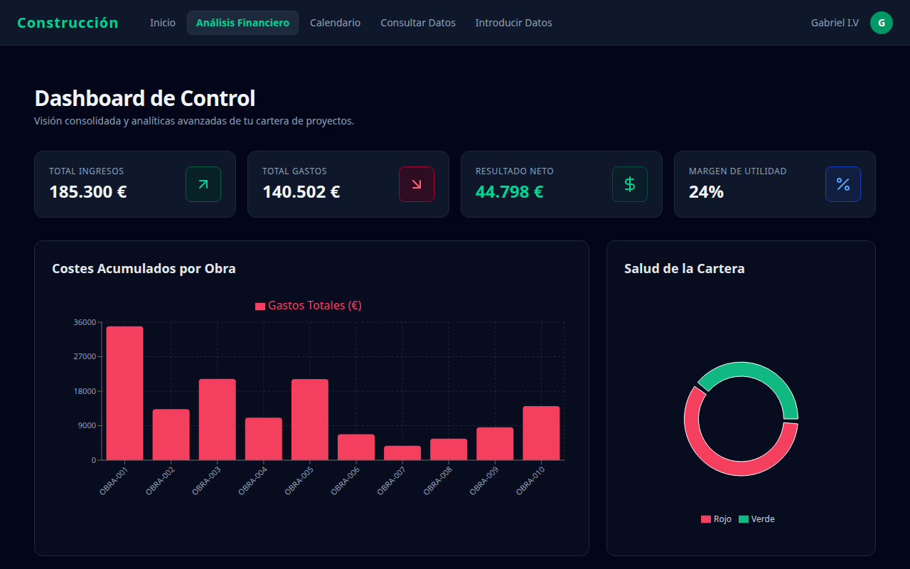
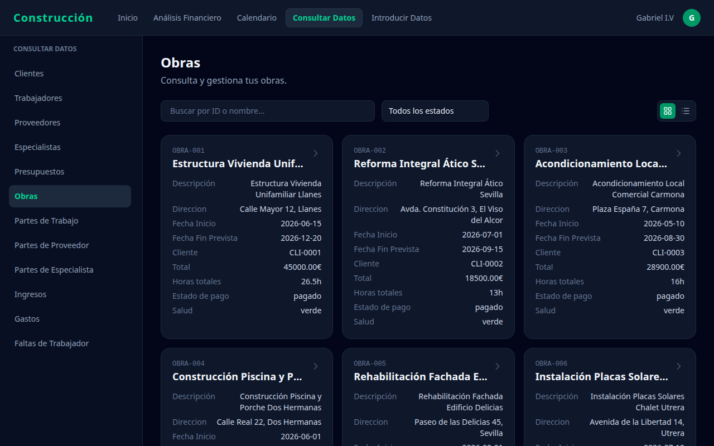
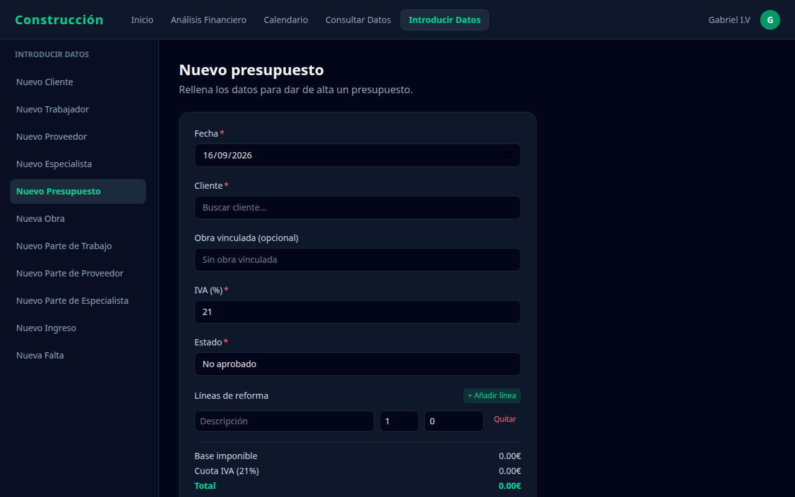
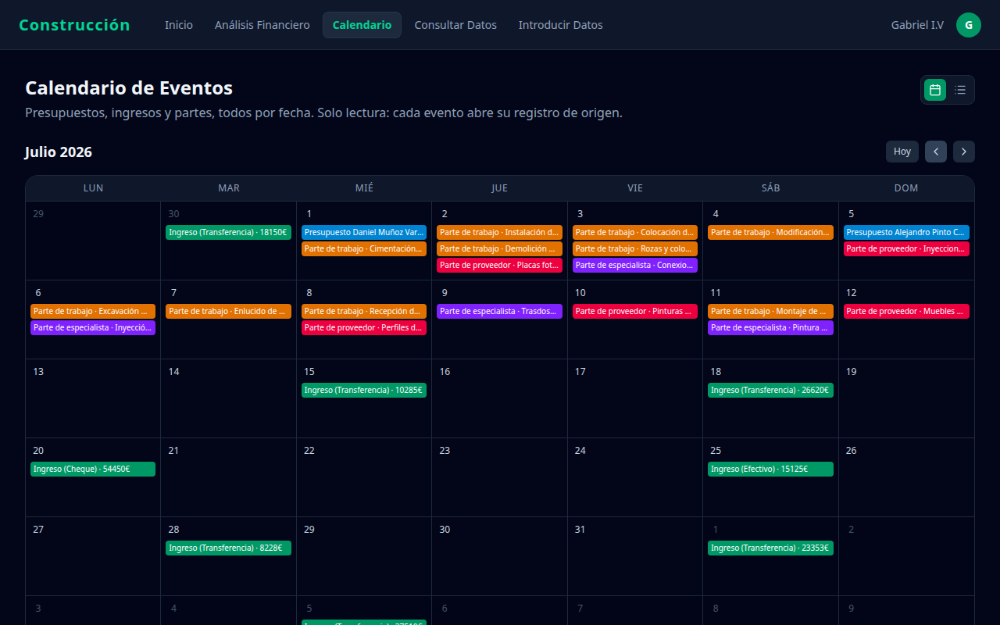
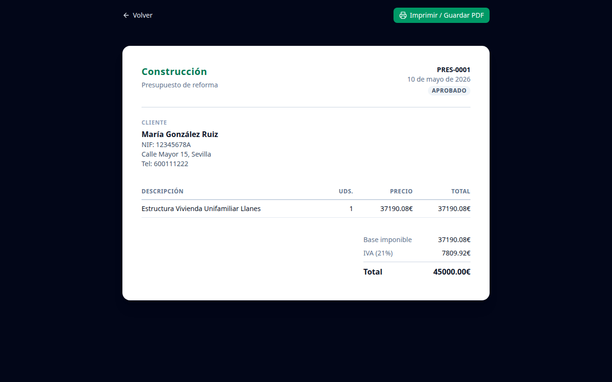

<a id="top"></a>
# ERP Construcción

[Español](./README.md) | **English**

### A frontend-only ERP for construction companies: projects, quotes, work reports, payments and financial tracking, with a dashboard, a calendar and PDF documents

[](https://github.com/pdawgabriel-hub/dashboard-financiero/actions/workflows/ci.yml)
[](https://pdawgabriel-hub.github.io/dashboard-financiero/)


**[Open the demo](https://dashboard-financiero-kappa-blue.vercel.app/)** · **[Technical guide (Spanish)](https://pdawgabriel-hub.github.io/dashboard-financiero/)**

The app's interface is in Spanish. Below, each feature is named as it appears in the app, with its English meaning.

---

## Table of contents

- [Overview](#overview)
- [Architecture](#architecture)
- [Main features](#features)
  - [1. Business cycle](#business-cycle)
  - [2. Financial analysis](#financial-analysis)
  - [3. Calendar and documents](#calendar-documents)
  - [4. User experience](#user-experience)
- [Business rules](#business-rules)
- [Screenshots](#screenshots)
- [Getting started](#getting-started)
- [Quality](#quality)
- [Technical documentation](#technical-documentation)
- [License](#license)
- [Author](#author)

---

<a id="overview"></a>
## Overview

**ERP Construcción** digitises the management of a construction and renovation company: clients, quotes, construction projects, in-house labour, external suppliers and specialists, customer payments and the financial tracking of each project. It answers the questions a project manager asks every day:

- How much is this project worth, according to the quotes the client has approved?
- How much have we spent on labour, materials and subcontractors?
- How much has the client paid, and how much do they still owe?
- Are we actually making or losing money, based on what has been collected?
- What happened each day: which quotes, payments and work reports are on the calendar?

The business model, with its 12 entities and its financial rules, comes from a **real ERP I built as a custom Odoo module** for a company in the sector, which is in production. Since that project holds real client data, this version reproduces its full business cycle as a **frontend-only** application with fictitious data that anyone can open and use end to end.

### How it is built

- **No backend.** Everything runs in the browser: data is stored in `localStorage` and seeded with 10 sample records per entity, linked to each other. Each visitor has their own data, and a version guard reseeds it if its shape changes.
- **Services that hold the business rules** (`src/servicios/`). A generic CRUD per entity and, on top of it, the functions that compute a project's total, profit, outstanding balance and health. They are computed on read and never stored, so there is nothing to keep in sync.
- **Validated forms** with React Hook Form and Zod, and **reusable screens**: a shared listing grid, a generic form and record pages that show their related records.

The project is a **frontend portfolio piece**: a layered React and TypeScript architecture, complex forms with dynamic line items, real business logic kept apart from the UI, and a complete product for a real use case.

[Back to top](#top)

---

<a id="architecture"></a>
## Architecture


Each layer, how a read and a write flow through them, and why there is no backend: [technical guide, Arquitectura](https://pdawgabriel-hub.github.io/dashboard-financiero/arquitectura/) (in Spanish).

[Back to top](#top)

---

<a id="features"></a>
## Main features

Navigation follows the business cycle: **Inicio** (home), **Análisis Financiero** (financial analysis), **Calendario** (calendar), **Consultar Datos** (12 listings, each with its record page) and **Introducir Datos** (11 creation forms).

<a id="business-cycle"></a>
### 1. Business cycle

| Module | Description |
|---|---|
| **Clientes** (clients) | Contact and tax details. The record page lists the client's quotes, projects and payments. |
| **Presupuestos** (quotes) | Line items (units × price) plus VAT. They copy the client's details when created and only count towards the project once approved. |
| **Obras** (projects) | A project for a client. Its price, hours, payment status and financial health are computed automatically. |
| **Partes de Trabajo** (work reports) | One task on one day, with a line per worker: hours × their hourly rate, which is copied when the worker is chosen and does not change if the rate goes up later. |
| **Partes de Proveedor / de Especialista** (supplier / specialist reports) | Each external invoice or service charged to a project. |
| **Ingresos** (payments) | Each payment from the client, always tied to a project. |
| **Gastos** (cost tracking) | A 1:1 sheet per project that brings together costs, payments, profit and outstanding balance. It is never created by hand: it comes with its project. |
| **Trabajadores, Proveedores, Especialistas** (workers, suppliers, specialists) | Catalogues with their rate or reference amount. Each record page lists their reports (and, for workers, their absences). |
| **Faltas de Trabajador** (worker absences) | Holidays, sick leave and absences, with the number of days computed. |

<a id="financial-analysis"></a>
### 2. Financial analysis

| Block | Description |
|---|---|
| **KPIs** | Income, costs, net result and margin for the whole portfolio: the sum of every project's cost-tracking sheet, so the dashboard and the sheets always match. |
| **Costs per project** | Total cost of each project: suppliers, specialists and labour. |
| **Portfolio health** | How many projects are green (fully paid), amber (in progress, no losses) and red (losing money). |
| **Cost over time** | Costs per month, by the date of each report. |
| **Detail** | Latest transactions and a breakdown of each project with its total and health. |

<a id="calendar-documents"></a>
### 3. Calendar and documents

| Module | Description |
|---|---|
| **Calendario** (calendar) | Monthly view of quotes, payments and the three kinds of report, colour-coded by type, with a panel showing each day's events. Also available as a list with search and filters. |
| **PDF documents** | Quote, work report and cost tracking, laid out as documents and exported to PDF from the browser, with no libraries. |

<a id="user-experience"></a>
### 4. User experience

- **Card or list view** in every listing, with search and a status filter; the whole card opens the record.
- **Related records** on record pages, ERP-style: a client's quotes, projects and payments, the reports of a project or a worker…
- **Searchable selectors**: find a client, project or worker by typing their name, tax ID or description, not just their code.
- **Inline validation**, with the message next to the field, and **notifications** after saving or deleting.
- **Responsive design** for mobile, tablet and desktop.

[Back to top](#top)

---

<a id="business-rules"></a>
## Business rules

The figures come from a few rules, inherited from the original ERP, applied the same way in the listing, the record page, the dashboard and the PDF:

```
project total        = Σ approved quotes of the project
costs                = supplier reports + specialist reports + labour (hours × frozen hourly rate)
actual profit        = collected − costs              ← cash, never quoted − costs
outstanding balance  = project total − collected
health               = red if losing money · green if fully paid · amber otherwise
```

The most important one is profit: the original ERP once computed it from the quoted amount and showed profits that did not exist yet. All formulas, validations and edge cases: [technical guide, Reglas de negocio](https://pdawgabriel-hub.github.io/dashboard-financiero/reglas-negocio/) (in Spanish).

[Back to top](#top)

---

<a id="screenshots"></a>
## Screenshots

| Financial dashboard |
|---|
|  |

| Project listing (card view) | Form |
|---|---|
|  |  |

| Monthly calendar | Printable document (PDF) |
|---|---|
|  |  |

[Back to top](#top)

---

<a id="getting-started"></a>
## Getting started

You need **Node.js 24** and **pnpm**:

```bash
git clone https://github.com/pdawgabriel-hub/dashboard-financiero.git
cd dashboard-financiero
pnpm install
pnpm dev          # http://localhost:5173
pnpm build        # type-checks and builds for production
```

Nothing else to configure: no environment variables, backend or database. The first visit seeds the sample data.

The app is deployed at **[dashboard-financiero-kappa-blue.vercel.app](https://dashboard-financiero-kappa-blue.vercel.app/)**.

[Back to top](#top)

---

<a id="quality"></a>
## Quality

- **Strict TypeScript** end to end, with one type per entity and another for creation that does not let the `id` or computed fields through.
- **Zod validation** on every form before saving.
- **A single source for every calculation**: no screen computes an amount on its own.
- **Continuous integration with GitHub Actions**: every push type-checks the project and builds it for production, as Vercel does. The **CI** badge above shows the result of the latest commit.

What is still pending (linting the remaining screens and tests for the business rules) is described in the [technical guide, Calidad](https://pdawgabriel-hub.github.io/dashboard-financiero/calidad/) (in Spanish).

[Back to top](#top)

---

<a id="technical-documentation"></a>
## Technical documentation

All the technical documentation is in the **[technical guide](https://pdawgabriel-hub.github.io/dashboard-financiero/)** (in Spanish), published on GitHub Pages:

| Page | What it covers |
|---|---|
| [Arquitectura](https://pdawgabriel-hub.github.io/dashboard-financiero/arquitectura/) | The app's layers and why there is no backend |
| [Modelo de datos](https://pdawgabriel-hub.github.io/dashboard-financiero/modelo-datos/) | Entities, relationships and computed fields |
| [Reglas de negocio](https://pdawgabriel-hub.github.io/dashboard-financiero/reglas-negocio/) | Financial formulas and validations |
| [Recorrido por el código](https://pdawgabriel-hub.github.io/dashboard-financiero/codigo/) | Recurring patterns, with real code excerpts |
| [Dashboard, calendario e informes](https://pdawgabriel-hub.github.io/dashboard-financiero/dashboard/) | What each chart computes and how PDF printing works |
| [Desarrollo local](https://pdawgabriel-hub.github.io/dashboard-financiero/desarrollo-local/) | Installation, commands and resetting the data |
| [Calidad](https://pdawgabriel-hub.github.io/dashboard-financiero/calidad/) | Types, validation, lint and continuous integration |
| [Despliegue](https://pdawgabriel-hub.github.io/dashboard-financiero/despliegue/) | Vercel and publishing the guide |
| [Origen y decisiones](https://pdawgabriel-hub.github.io/dashboard-financiero/decisiones/) | From the Odoo ERP to this version: what is kept, what changes and what is missing |
| [Dónde tocar para…](https://pdawgabriel-hub.github.io/dashboard-financiero/donde-tocar/) | Which files to change for the most common changes |

[Back to top](#top)

---

<a id="license"></a>
## License

This project is published as a **personal portfolio piece** under a restricted-use license. In short:

- You may **view, clone and run** the code for **learning, technical evaluation or portfolio review** (for example, as part of a hiring process or to study the project's architecture).
- You may **modify the code for personal, non-commercial use**, always crediting the original author.
- **Commercial use is not allowed**, in whole or in part (including deploying it as a product or service, reselling it or integrating it into third-party commercial solutions), without the author's express permission.
- **The original author is the only party entitled to exploit the project commercially**: [Gabriel](https://github.com/pdawgabriel-hub).

The full legal text is in [`LICENSE.en.md`](./LICENSE.en.md) (Spanish version: [`LICENSE.md`](./LICENSE.md)).

[Back to top](#top)

---

<a id="author"></a>
## Author

Built by **Gabriel Iborra Vicente** as a portfolio project, to demonstrate frontend development of a complete management application: a layered React and TypeScript architecture, complex forms, real business logic kept apart from the UI, and a product that replicates an ERP running in production.

[Back to top](#top)
