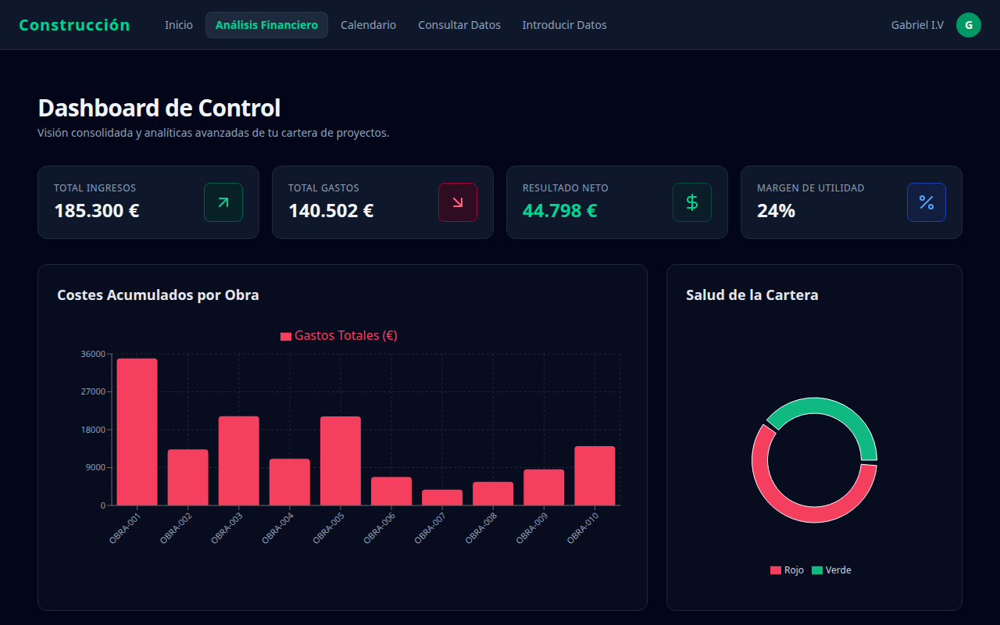
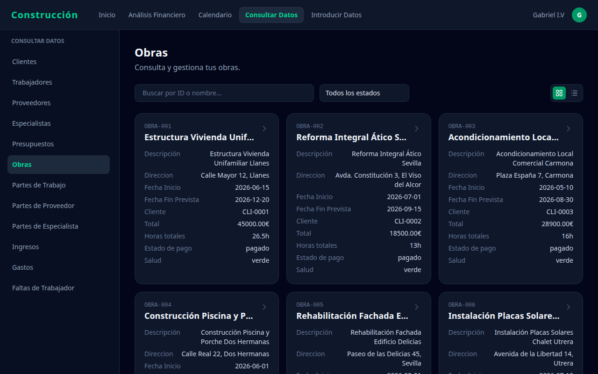
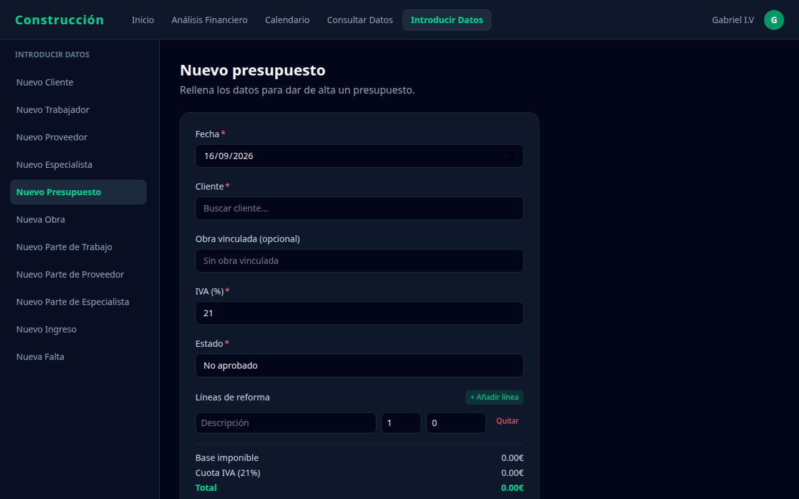
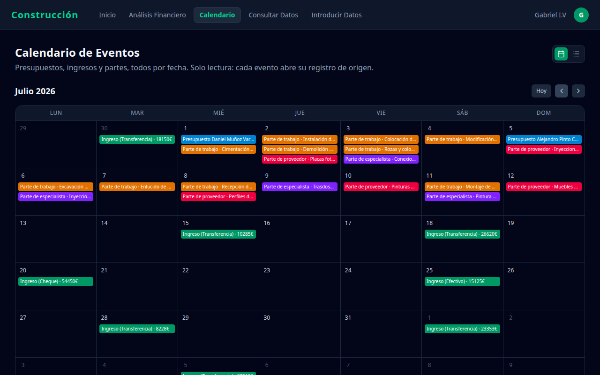
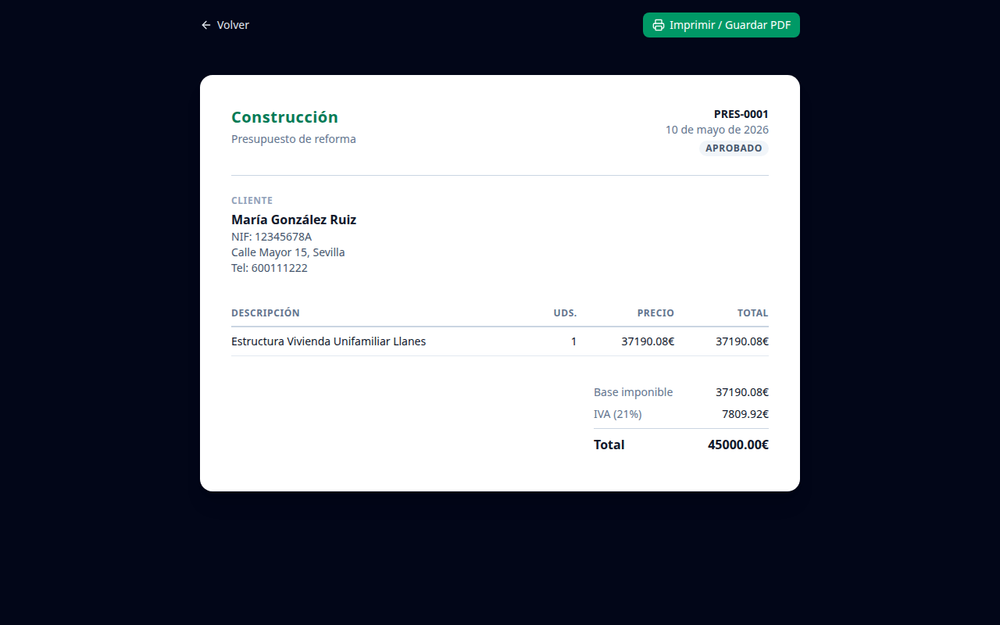

<a id="top"></a>
# ERP Construcción - Dashboard Financiero

**Español** | [English](./README.en.md)

### Versión 100% frontend de mi ERP a Medida para Construcción y Reformas (Odoo 18, en producción): mismo ciclo de negocio, mismas reglas financieras y mismo Análisis Financiero, en React y sin backend

[](https://github.com/pdawgabriel-hub/dashboard-financiero/actions/workflows/ci.yml)
[](https://pdawgabriel-hub.github.io/dashboard-financiero/)


**[Abrir la demo](https://dashboard-financiero-kappa-blue.vercel.app/)** · **[Guía técnica](https://pdawgabriel-hub.github.io/dashboard-financiero/)**

---

## Índice

- [Descripción general](#descripcion-general)
- [Arquitectura](#arquitectura)
- [Características principales](#caracteristicas)
  - [1. Ciclo de negocio](#ciclo-negocio)
  - [2. Análisis financiero](#analisis-financiero)
  - [3. Calendario e informes](#calendario-informes)
  - [4. Experiencia de uso](#experiencia)
- [Reglas de negocio](#reglas-negocio)
- [Capturas de pantalla](#capturas)
- [Puesta en marcha](#puesta-en-marcha)
- [Calidad](#calidad)
- [Documentación técnica](#documentacion-tecnica)
- [Licencia](#licencia)
- [Autor](#autor)

---

<a id="descripcion-general"></a>
## Descripción general

**ERP Construcción - Dashboard Financiero** es la versión frontend de mi **ERP a Medida para Construcción y Reformas**, el ERP que desarrollé sobre **Odoo 18** para una empresa real de construcción y reformas y que está **en producción** desde octubre de 2026. Como el ERP trabaja con datos reales de clientes y no se puede enseñar, este proyecto reproduce en React su ciclo de negocio completo (cliente → presupuesto → obra → partes de trabajo, de especialista y de proveedor → gastos e ingresos → beneficio real), con datos ficticios y sin backend, para que cualquiera pueda abrirlo y usarlo entero.

Igual que el ERP, responde a las preguntas que se hace cada día quien dirige una obra:

- ¿Cuánto vale esta obra, según los presupuestos que el cliente ha aprobado?
- ¿Cuánto llevamos gastado en mano de obra, materiales y subcontratas?
- ¿Cuánto nos ha pagado el cliente y cuánto nos debe todavía?
- ¿Estamos ganando o perdiendo dinero, de verdad, con lo cobrado?
- ¿Qué pasó cada día: qué presupuestos, cobros y partes hay en el calendario?

Del ERP conserva los 12 modelos de negocio, las reglas financieras y la terminología: los menús (Gestión de Obras, Análisis Financiero, Consultar Datos), los KPIs (Ingresos Cobrados, Gastos Totales, Beneficio Real), el Seguimiento de Gastos de cada obra, los informes (Imprimir Presupuesto, Imprimir Parte, Imprimir Seguimiento) y los códigos de los registros (`OBR0001`, `PREP0001`, `CLI0001`…). Qué cambia y qué falta respecto al ERP: [guía técnica, Origen y decisiones](https://pdawgabriel-hub.github.io/dashboard-financiero/decisiones/).

### Cómo está construido

- **Sin backend.** Todo ocurre en el navegador: los datos se guardan en `localStorage` y se siembran con 10 registros de ejemplo por entidad, relacionados entre sí. Cada visitante tiene sus propios datos, y una guarda de versión los resiembra si cambia su forma.
- **Servicios con las reglas de negocio** (`src/servicios/`). Un CRUD genérico por entidad y, encima, las funciones que calculan el total de la obra, el beneficio, el pendiente de cobro o la salud. Se calculan al leer y nunca se guardan, así que no hay nada que mantener sincronizado.
- **Formularios validados** con React Hook Form y Zod, y **pantallas reutilizables**: una rejilla de consulta común, un formulario genérico y fichas con sus registros relacionados.

El proyecto es una pieza de **portfolio de frontend**: arquitectura por capas en React y TypeScript, formularios complejos con líneas dinámicas, lógica de negocio real separada de la interfaz y la adaptación de un ERP en producción a una aplicación web pública.

[Volver arriba](#top)

---

<a id="arquitectura"></a>
## Arquitectura


Detalle de cada capa, del flujo de una lectura y una escritura y de por qué no hay backend: [guía técnica, Arquitectura](https://pdawgabriel-hub.github.io/dashboard-financiero/arquitectura/).

[Volver arriba](#top)

---

<a id="caracteristicas"></a>
## Características principales

La navegación, bajo **Gestión de Obras** como en el ERP, sigue el ciclo de negocio: **Inicio**, **Análisis Financiero**, **Calendario**, **Consultar Datos** (12 listados con su ficha) e **Introducir Datos** (11 formularios de alta).

<a id="ciclo-negocio"></a>
### 1. Ciclo de negocio

| Módulo | Descripción |
|---|---|
| **Clientes** | Datos de contacto y fiscales. Su ficha muestra sus presupuestos, obras e ingresos. |
| **Presupuestos** | Líneas de reforma (unidades × precio) con IVA. Copian los datos del cliente al crearse y solo cuentan para la obra si están aprobados. |
| **Obras** | Proyecto para un cliente. Su total presupuesto, horas, estado de pago y salud financiera (verde, ámbar o rojo) se calculan solos. |
| **Partes de Trabajo** | Una tarea de un día, con una línea por trabajador: horas × su tarifa, que se copia al elegirlo y no cambia aunque la tarifa suba después. |
| **Partes de Proveedor y de Especialista** | Cada factura o servicio externo imputado a una obra. |
| **Ingresos** | Cada cobro del cliente, siempre ligado a una obra. |
| **Seguimiento de Gastos** | Ficha financiera 1:1 de cada obra que junta gastos, ingresos, beneficio real y pendiente de cobro. No se da de alta a mano: nace con su obra. |
| **Trabajadores, Proveedores, Especialistas** | Catálogos con su tarifa o importe de referencia. Cada ficha muestra sus partes (y, la del trabajador, sus faltas). |
| **Faltas de Trabajador** | Vacaciones, bajas y ausencias, con los días calculados. |

<a id="analisis-financiero"></a>
### 2. Análisis financiero

| Bloque | Descripción |
|---|---|
| **KPIs** | Ingresos Cobrados, Gastos Totales, Beneficio Real y Margen de Beneficio de toda la cartera de obras: la suma del Seguimiento de Gastos de todas las obras, así que el Análisis Financiero y las fichas siempre coinciden. |
| **Costes Acumulados por Obra** | Gasto total de cada obra: proveedores, especialistas y mano de obra. |
| **Salud de las Obras** | Cuántas obras están en verde (cobradas), ámbar (en curso, sin pérdidas) y rojo (con pérdidas). |
| **Evolución Mensual de Gastos** | Gastos por mes, según la fecha de cada parte. |
| **Detalle** | Últimos gastos imputados y desglose de cada obra con su total presupuesto y su salud. |

<a id="calendario-informes"></a>
### 3. Calendario e informes

| Módulo | Descripción |
|---|---|
| **Calendario** | Vista mensual de presupuestos, cobros y los tres tipos de parte, con un color por tipo y un panel con el detalle de cada día. También en lista, con buscador y filtro. |
| **Informes PDF** | Presupuesto, Parte de Trabajo y Seguimiento de Gastos en Obra, maquetados como documentos y exportables a PDF desde el navegador, sin librerías. |

<a id="experiencia"></a>
### 4. Experiencia de uso

- **Vista de tarjetas o de lista** en todos los listados, con buscador y filtro por estado; toda la tarjeta lleva a la ficha.
- **Registros relacionados** en las fichas, al estilo de un ERP: los presupuestos, obras e ingresos de un cliente, los partes de una obra o de un trabajador…
- **Selectores con búsqueda**: se encuentra un cliente, una obra o un trabajador escribiendo su nombre, NIF o descripción, no solo su código.
- **Validación en el momento**, con el mensaje junto al campo, y **avisos** tras guardar o borrar.
- **Diseño adaptable** a móvil, tablet y ordenador.

[Volver arriba](#top)

---

<a id="reglas-negocio"></a>
## Reglas de negocio

Las cifras salen de las mismas reglas que el ERP, y se aplican igual en el listado, la ficha, el Análisis Financiero y el PDF:

```
total presupuesto   = Σ presupuestos aprobados de la obra
gastos              = partes de proveedor + partes de especialista + mano de obra (horas × tarifa congelada)
beneficio real      = ingresos cobrados − gastos    ← caja, nunca presupuesto − gastos
pendiente de cobro  = total presupuesto − ingresos cobrados
salud               = rojo si hay pérdidas · verde si está cobrada · ámbar en otro caso
```

La más importante es la del beneficio real: en el ERP se calculaba al principio con lo presupuestado y daba beneficios que todavía no existían. Todas las fórmulas, las validaciones y los casos límite: [guía técnica, Reglas de negocio](https://pdawgabriel-hub.github.io/dashboard-financiero/reglas-negocio/).

[Volver arriba](#top)

---

<a id="capturas"></a>
## Capturas de pantalla

| Análisis Financiero |
|---|
|  |

| Listado de obras (vista de tarjetas) | Formulario |
|---|---|
|  |  |

| Calendario mensual | Documento imprimible (PDF) |
|---|---|
|  |  |

[Volver arriba](#top)

---

<a id="puesta-en-marcha"></a>
## Puesta en marcha

Necesitas **Node.js 24** y **pnpm**:

```bash
git clone https://github.com/pdawgabriel-hub/dashboard-financiero.git
cd dashboard-financiero
pnpm install
pnpm dev          # http://localhost:5173
pnpm build        # comprueba los tipos y genera la versión de producción
```

No hace falta configurar nada: no hay variables de entorno, backend ni base de datos. La primera visita siembra los datos de ejemplo.

La app está desplegada en **[dashboard-financiero-kappa-blue.vercel.app](https://dashboard-financiero-kappa-blue.vercel.app/)**.

[Volver arriba](#top)

---

<a id="calidad"></a>
## Calidad

- **TypeScript estricto** de extremo a extremo, con un tipo por entidad y otro para crear, que no deja pasar el `id` ni los campos calculados.
- **Validación con Zod** en todos los formularios antes de guardar.
- **Una sola fuente para cada cálculo**: ninguna pantalla recalcula un importe por su cuenta.
- **Integración continua con GitHub Actions**: en cada push se comprueban los tipos y se genera la versión de producción, igual que en Vercel. La insignia **CI** de arriba muestra el resultado del último commit.

Lo que queda pendiente (lint del resto de pantallas y tests de las reglas de negocio) está en la [guía técnica, Calidad](https://pdawgabriel-hub.github.io/dashboard-financiero/calidad/).

[Volver arriba](#top)

---

<a id="documentacion-tecnica"></a>
## Documentación técnica

Toda la documentación técnica está en la **[guía técnica](https://pdawgabriel-hub.github.io/dashboard-financiero/)**, publicada en GitHub Pages:

| Página | Qué explica |
|---|---|
| [Arquitectura](https://pdawgabriel-hub.github.io/dashboard-financiero/arquitectura/) | Las capas de la app y por qué no hay backend |
| [Modelo de datos](https://pdawgabriel-hub.github.io/dashboard-financiero/modelo-datos/) | Las entidades, sus relaciones y qué campos se calculan |
| [Reglas de negocio](https://pdawgabriel-hub.github.io/dashboard-financiero/reglas-negocio/) | Las fórmulas financieras y las validaciones |
| [Recorrido por el código](https://pdawgabriel-hub.github.io/dashboard-financiero/codigo/) | Los patrones que se repiten, con fragmentos reales |
| [Análisis Financiero, calendario e informes](https://pdawgabriel-hub.github.io/dashboard-financiero/dashboard/) | Qué calcula cada gráfico y cómo se imprime a PDF |
| [Desarrollo local](https://pdawgabriel-hub.github.io/dashboard-financiero/desarrollo-local/) | Instalación, comandos y cómo reiniciar los datos |
| [Calidad](https://pdawgabriel-hub.github.io/dashboard-financiero/calidad/) | Tipos, validación, lint e integración continua |
| [Despliegue](https://pdawgabriel-hub.github.io/dashboard-financiero/despliegue/) | Vercel y la publicación de la guía |
| [Origen y decisiones](https://pdawgabriel-hub.github.io/dashboard-financiero/decisiones/) | Del ERP en producción a esta versión: qué se conserva, qué cambia y qué falta |
| [Dónde tocar para…](https://pdawgabriel-hub.github.io/dashboard-financiero/donde-tocar/) | Qué ficheros cambiar para los cambios más habituales |

[Volver arriba](#top)

---

<a id="licencia"></a>
## Licencia

Este proyecto se publica como **pieza de portfolio personal** y tiene una licencia de uso restringido. En detalle:

- Puedes **ver, clonar y ejecutar** el código con fines de **aprendizaje, evaluación técnica o revisión de portfolio** (por ejemplo, como parte de un proceso de selección o para estudiar la arquitectura del proyecto).
- Puedes **modificar el código para uso personal, no comercial**, siempre citando la autoría original.
- **No está permitido el uso comercial** del proyecto, ni total ni parcial (incluyendo su despliegue como producto o servicio, su reventa o su integración en soluciones comerciales de terceros) sin autorización expresa del autor.
- **El único titular con derecho a explotación comercial del proyecto es el autor original**, [Gabriel](https://github.com/pdawgabriel-hub).

El texto legal completo se encuentra en [`LICENSE.md`](./LICENSE.md) (versión en inglés: [`LICENSE.en.md`](./LICENSE.en.md)).

[Volver arriba](#top)

---

<a id="autor"></a>
## Autor

Desarrollado por **Gabriel Iborra Vicente** como proyecto de portfolio, con el objetivo de demostrar el desarrollo frontend de una aplicación de gestión completa: arquitectura por capas en React y TypeScript, formularios complejos, lógica de negocio real separada de la interfaz y la versión frontend de su ERP a Medida para Construcción y Reformas, en producción.

[Volver arriba](#top)
