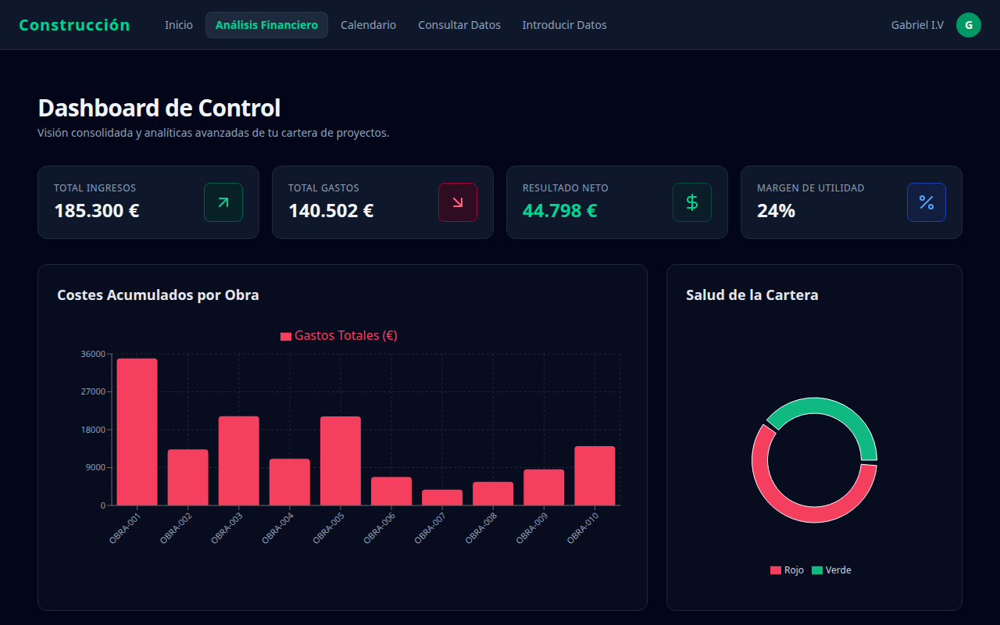
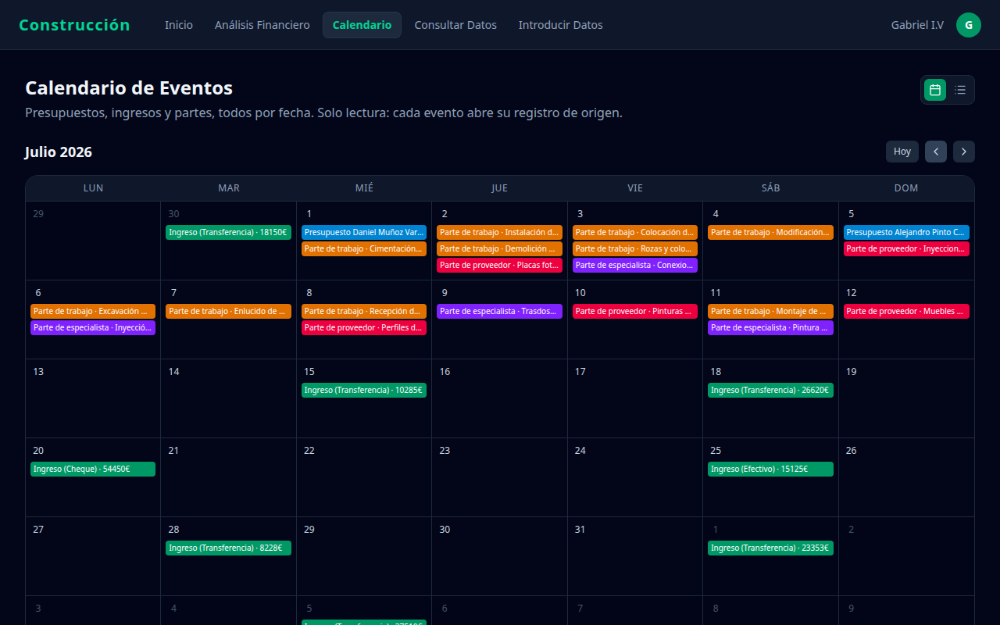
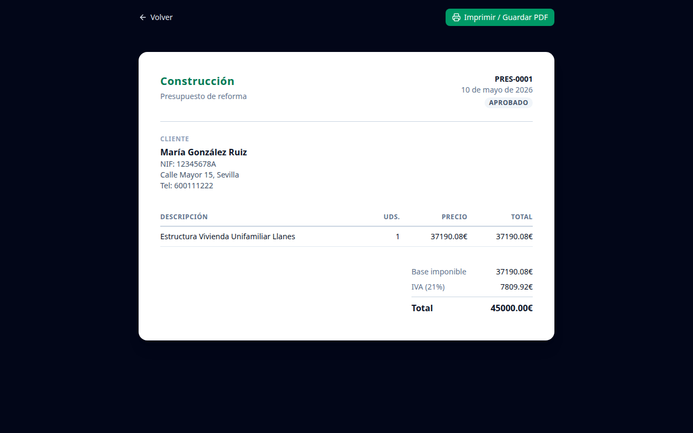

# Análisis Financiero, calendario e informes

## Análisis Financiero (dashboard) {#dashboard}

La página `src/paginas/PaginaDashboard/PaginaDashboard.tsx` solo pinta; los datos los prepara `src/servicios/DashboardAnalisis/DashboardAnalisis.tsx`. Como los datos se leen de `localStorage` de forma síncrona y no cambian mientras el Análisis Financiero está abierto, se calculan una sola vez al montar la página, con `useMemo`.

| Bloque | Qué muestra | Cómo se calcula |
|---|---|---|
| **KPIs** | Ingresos Cobrados, Gastos Totales, Beneficio Real y Margen de Beneficio | Suma, obra a obra, de lo que da el Seguimiento de Gastos de cada una: ingresos = cobros registrados; gastos = proveedores + especialistas + mano de obra; beneficio real = ingresos − gastos; margen = beneficio real / ingresos |
| **Costes acumulados por obra** (barras) | Gasto total de cada obra | Proveedores + especialistas + mano de obra de la obra |
| **Salud de las Obras** (anillo) | Cuántas obras están en verde, ámbar y rojo | `gastoService.getSaludObra()` de cada obra |
| **Evolución Mensual de Gastos** (área) | Gasto por mes | Partes de proveedor y de especialista por su importe, y partes de trabajo por su coste, cada uno en el mes de su fecha |
| **Últimos Gastos Imputados** | Los cuatro partes de proveedor o especialista más recientes | Ordenados por fecha |
| **Desglose de obras** | Cada obra con su salud y su total | `getObraTotal()` y `getSaludObra()` |

Como los KPIs suman las mismas funciones que usa el Seguimiento de Gastos, el Análisis Financiero y las fichas nunca dan cifras distintas.

!!! note "La evolución mensual agrupa por mes del año"
    El gráfico tiene doce barras, de enero a diciembre, y suma en cada una los gastos de ese mes de **cualquier año**. Con los datos de ejemplo, que caen en un mismo año, es la evolución anual; con datos de varios años, los mezclaría.

Los gráficos son de [Recharts](https://recharts.org/) y están en `src/componentes/Dashboard/`, uno por carpeta.

## Calendario {#calendario}

El calendario junta en una sola vista todo lo que tiene fecha: presupuestos, ingresos y los tres tipos de parte. No tiene datos propios: `getEventosCalendario()` (`src/servicios/CalendarioService/CalendarioService.ts`) recorre los cinco servicios cada vez que se abre y construye una lista de eventos con su tipo, un texto descriptivo y la ruta a la ficha de origen. En el ERP es una vista SQL con un `UNION ALL` de cinco tablas; aquí, la misma unión en memoria.

La página tiene dos vistas:

- **Mes** (`CalendarioMes`): rejilla mensual con un color por tipo de evento. Al pulsar un día se abre un panel con sus eventos, y cada uno enlaza a su ficha.
- **Lista**: los mismos eventos en `GridConsulta`, con buscador y filtro por tipo.

## Informes imprimibles (PDF) {#informes}

Tres fichas tienen un botón de impresión (**Imprimir Presupuesto**, **Imprimir Parte** e **Imprimir Seguimiento**, como en el ERP) que abre su documento en una pestaña nueva:

| Documento | Ruta | Contenido |
|---|---|---|
| Presupuesto | `/consultar/presupuestos/imprimir/:id` | Datos del cliente, líneas, base imponible, IVA y total |
| Parte de Trabajo | `/consultar/partes-trabajo/imprimir/:id` | Obra, tarea y horas y coste de cada trabajador |
| Seguimiento de Gastos en Obra | `/consultar/gastos/imprimir/:id` | Precio pactado, costes por tipo, cobros, beneficio y pendiente de cobro |

No hay ninguna librería de PDF:

- `App.tsx` detecta las rutas `/imprimir/` y las pinta con `RutasImprimir`, **sin menú ni barra lateral**.
- Cada documento usa `DocumentoImprimible`, una hoja blanca maquetada con Tailwind e independiente del tema oscuro de la app.
- El botón "Imprimir / Guardar PDF" llama a `window.print()`. La barra de acciones lleva `print:hidden`, así que no sale en el papel.
- `src/index.css` fija `@page { margin: 0 }` para que el navegador no añada su cabecera y pie (URL, fecha, número de página). Los márgenes del documento los pone el propio documento.
