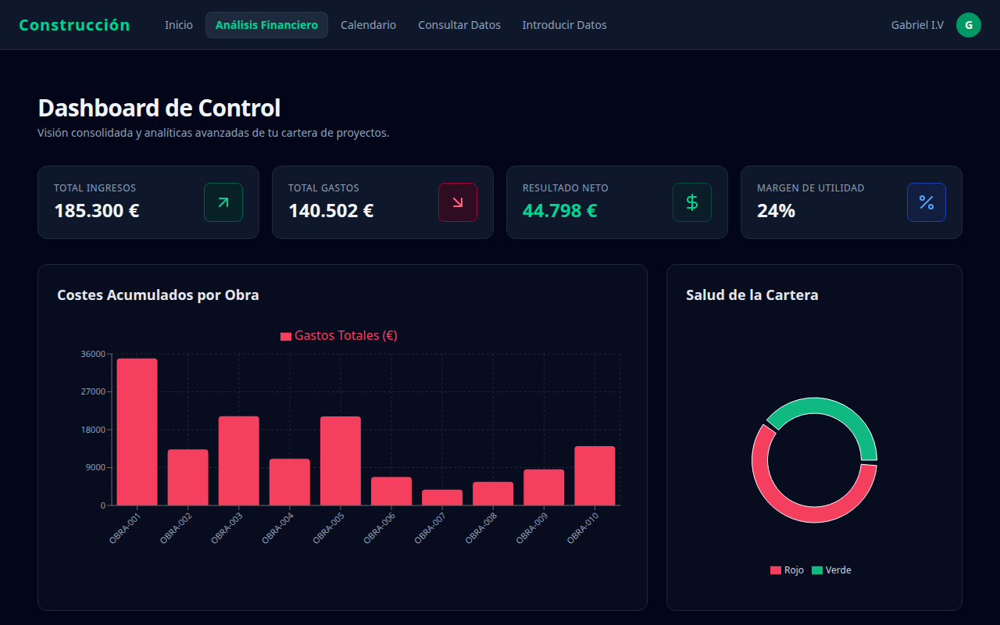

# ERP Construcción · Guía técnica

**ERP Construcción** es un ERP para una empresa de construcción y reformas hecho solo con frontend: clientes, presupuestos, obras, partes de trabajo, proveedores, especialistas, ingresos y el seguimiento financiero de cada obra, con un dashboard, un calendario y documentos imprimibles en PDF. Reproduce en React el modelo de negocio de un ERP real que desarrollé a medida sobre Odoo. Esta guía explica cómo está construido: cómo se organiza el código, dónde viven los datos, cómo se calculan las cifras y cómo se ejecuta y despliega.

[Abrir la demo](https://dashboard-financiero-kappa-blue.vercel.app/){ .md-button .md-button--primary }
[Código en GitHub](https://github.com/pdawgabriel-hub/dashboard-financiero){ .md-button }
[README del proyecto](https://github.com/pdawgabriel-hub/dashboard-financiero#readme){ .md-button }

## El proyecto en cifras

| | |
|---|---|
| Aplicación | SPA en React 19 y TypeScript, con Vite y Tailwind CSS, sin backend |
| Modelo de negocio | 12 entidades con datos propios (clientes, obras, presupuestos, tres tipos de parte, ingresos, gastos, faltas…) más un calendario que las une |
| Pantallas | 12 listados con su ficha de edición, 11 formularios de alta, dashboard, calendario mensual y 3 documentos imprimibles |
| Validación | 12 esquemas de Zod conectados a React Hook Form |
| Datos | `localStorage`, sembrado con 10 registros de ejemplo por entidad, coherentes entre sí |
| Cálculos | Total de obra, beneficio de caja, pendiente de cobro, estado de pago y salud, calculados al leer y nunca guardados |
| Despliegue | Vercel para la app; GitHub Pages para esta guía |

## Cómo leer esta guía

Si quieres entender el diseño, empieza por [Arquitectura](arquitectura.md) y sigue con [Reglas de negocio](reglas-negocio.md), que es donde está la lógica que importa. Si quieres ejecutar o modificar el proyecto, ve directamente a [Desarrollo local](desarrollo-local.md) y a [Dónde tocar para…](donde-tocar.md).

| Página | Qué explica |
|---|---|
| [Arquitectura](arquitectura.md) | Las capas de la app y por qué no hay backend |
| [Modelo de datos](modelo-datos.md) | Las entidades, sus relaciones y qué campos se calculan |
| [Reglas de negocio](reglas-negocio.md) | Las fórmulas financieras y las validaciones |
| [Recorrido por el código](codigo.md) | Los patrones que se repiten, con fragmentos reales |
| [Dashboard, calendario e informes](dashboard.md) | Qué calcula cada gráfico, cómo se arma el calendario y cómo se imprime a PDF |
| [Desarrollo local](desarrollo-local.md) | Instalación, comandos y cómo reiniciar los datos |
| [Calidad](calidad.md) | Tipado, validación, lint e integración continua |
| [Despliegue](despliegue.md) | Vercel y la publicación de esta guía |
| [Origen y decisiones](decisiones.md) | Del ERP en Odoo a esta versión: qué se conserva, qué cambia y qué falta |
| [Dónde tocar para…](donde-tocar.md) | Qué ficheros cambiar para los cambios más habituales |

!!! info "Convenciones"
    Los importes son euros con dos decimales. Las fechas se guardan como texto `AAAA-MM-DD`. Las rutas de ficheros son relativas a la raíz del repositorio.
